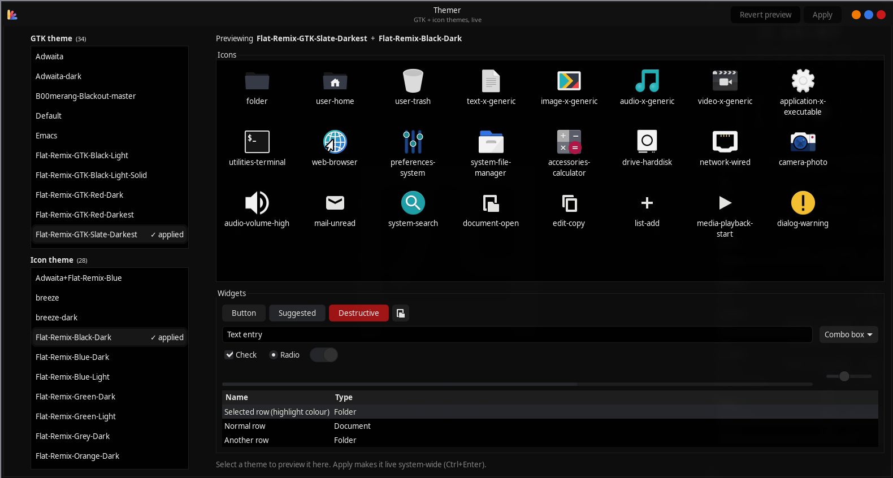

# themer

A small GTK app to switch your **GTK theme** and **icon theme** on a bare window manager (bspwm, i3, openbox, ...)
and see the result **live**, with no relogin. It is the missing "appearance settings" for setups without a desktop environment.



- Pick a theme and the Themer window itself restyles, next to a grid of that theme's icons and some sample
  widgets (buttons, entry, switch, a selected list row to judge the highlight colour). Nothing on your system changes yet.
- **Apply** (Ctrl+Enter) writes the choice everywhere it is stored and reloads it live.
- Also works headless: `themer --gtk NAME --icons NAME`.

## Install

```sh
git clone https://github.com/rippsec/themer && cd themer
./install.sh            # symlinks ~/.local/bin/themer and adds an app-menu entry
./install.sh --uninstall
```

Requirements: Python 3 with PyGObject and GTK 3 (`sudo apt install python3-gi gir1.2-gtk-3.0`).
Recommended: `xsettingsd` (it is what makes running apps switch theme live) and `gsettings` (GTK 4 / libadwaita apps).

## Usage

```
themer                                   # GUI
themer --gtk Adwaita-dark --icons Papirus   # apply without a window
themer --list                            # installed GTK and icon themes
themer --current                         # what is live right now
```

Themes are discovered in `~/.themes`, `~/.local/share/themes`, `/usr/share/themes` (GTK) and `~/.icons`,
`~/.local/share/icons`, `/usr/share/icons` (icons). Hidden and cursor-only icon themes are skipped.

## What Apply changes

| Target | Effect |
| --- | --- |
| `~/.config/xsettingsd/xsettingsd.conf` + `SIGHUP` | running GTK 2/3 apps switch immediately |
| `gsettings` (`org.gnome.desktop.interface`) | running GTK 4 / libadwaita apps |
| `~/.config/gtk-3.0/settings.ini`, `gtk-4.0/settings.ini` | GTK apps started later |
| `~/.gtkrc-2.0` | GTK 2 apps |
| `~/.config/qt5ct/qt5ct.conf`, `qt6ct/qt6ct.conf` | Qt icon theme (apps pick it up when restarted) |
| `~/.config/themer/hooks.d/*` | your own scripts, see below |

Files are created or edited in place, only the theme keys are touched, and a file that is already up to date is left alone.
Missing config files are created for GTK and xsettingsd; qt5ct/qt6ct are only edited if they exist.

## Hooks

Put executables in `~/.config/themer/hooks.d/`. They run after every apply (in name order, 15 s timeout) with
`THEMER_GTK` and `THEMER_ICONS` set. Example, keep rofi's icon theme in sync:

```sh
#!/bin/sh
# ~/.config/themer/hooks.d/10-rofi   (chmod +x)
sed -i -E "s|(icon-theme:\s*)\"[^\"]*\"|\1\"$THEMER_ICONS\"|" ~/.config/rofi/config.rasi
```

## Limits

- Qt apps only get the new **icons**, and only after a restart (qt5ct/qt6ct have no live-reload). The Qt style is not touched.
- The cursor theme and fonts are not managed.
- Some GTK apps cache their theme and need a restart even with xsettingsd.

## License

GPL-2.0, see [LICENSE](LICENSE).
